

<picture><source media="(prefers-color-scheme: dark)" srcset="assets/banner-dark.svg"></picture>

<a href="https://mukulray1603.github.io"><picture><source media="(prefers-color-scheme: dark)" srcset="assets/btn-portfolio-dark.svg"></picture></a>
<a href="https://mukulray1603.github.io/assets/Mukul_Rayana_Resume.pdf"><picture><source media="(prefers-color-scheme: dark)" srcset="assets/btn-resume-dark.svg"></picture></a>
<a href="https://linkedin.com/in/mukul-rayana"><picture><source media="(prefers-color-scheme: dark)" srcset="assets/btn-linkedin-dark.svg"></picture></a>
<a href="https://huggingface.co/spaces/MukulRay"><picture><source media="(prefers-color-scheme: dark)" srcset="assets/btn-hf-dark.svg"></picture></a>
<a href="mailto:ai.mukulray@gmail.com"><picture><source media="(prefers-color-scheme: dark)" srcset="assets/btn-email-dark.svg"></picture></a>

 

<picture><source media="(prefers-color-scheme: dark)" srcset="assets/now-dark.svg"></picture>

 

<picture><source media="(prefers-color-scheme: dark)" srcset="assets/title-highlights-dark.svg"></picture>

<picture><source media="(prefers-color-scheme: dark)" srcset="assets/highlights-dark.svg">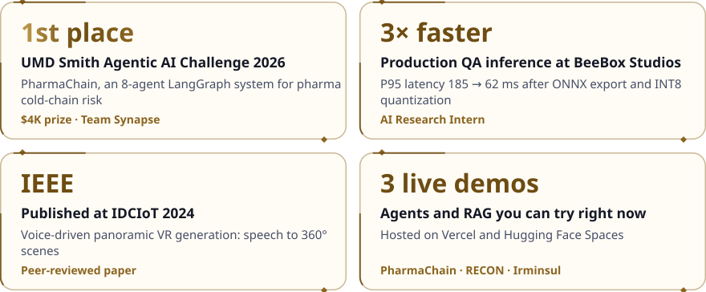</picture>

 

<picture><source media="(prefers-color-scheme: dark)" srcset="assets/title-work-dark.svg"></picture>

  <a href="https://github.com/MukulRay1603/PharmaChain"><picture><source media="(prefers-color-scheme: dark)" srcset="assets/card-pharmachain-dark.svg"></picture></a>
  <a href="https://github.com/MukulRay1603/nemesis-boss-ai"><picture><source media="(prefers-color-scheme: dark)" srcset="assets/card-nemesis-dark.svg"></picture></a>

  <a href="https://github.com/MukulRay1603/Empath-RAG"><picture><source media="(prefers-color-scheme: dark)" srcset="assets/card-empathrag-dark.svg"></picture></a>
  <a href="https://github.com/MukulRay1603/project-recon"><picture><source media="(prefers-color-scheme: dark)" srcset="assets/card-recon-dark.svg"></picture></a>

  <a href="https://github.com/MukulRay1603/Irminsul"><picture><source media="(prefers-color-scheme: dark)" srcset="assets/card-irminsul-dark.svg"></picture></a>
  <a href="https://github.com/MukulRay1603/DocPilot"><picture><source media="(prefers-color-scheme: dark)" srcset="assets/card-docpilot-dark.svg"></picture></a>

  <a href="https://github.com/MukulRay1603/eldervale"><picture><source media="(prefers-color-scheme: dark)" srcset="assets/card-eldervale-dark.svg"></picture></a>
  <a href="https://ieeexplore.ieee.org/document/10467441"><picture><source media="(prefers-color-scheme: dark)" srcset="assets/card-vrgen-dark.svg">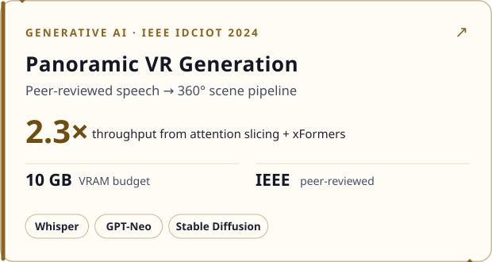</picture></a>

 

<picture><source media="(prefers-color-scheme: dark)" srcset="assets/title-live-dark.svg"></picture>

<a href="https://ai-cargo-monitor-prod.vercel.app"><picture><source media="(prefers-color-scheme: dark)" srcset="assets/btn-demo-pharmachain-dark.svg"></picture></a>
<a href="https://huggingface.co/spaces/MukulRay/recon"><picture><source media="(prefers-color-scheme: dark)" srcset="assets/btn-demo-recon-dark.svg"></picture></a>
<a href="https://mukulray-irminsul.hf.space"><picture><source media="(prefers-color-scheme: dark)" srcset="assets/btn-demo-irminsul-dark.svg"></picture></a>
<a href="https://eldervale-game.netlify.app"><picture><source media="(prefers-color-scheme: dark)" srcset="assets/btn-demo-eldervale-dark.svg"></picture></a>

 

<picture><source media="(prefers-color-scheme: dark)" srcset="assets/title-toolkit-dark.svg"></picture>

<picture><source media="(prefers-color-scheme: dark)" srcset="assets/toolkit-dark.svg">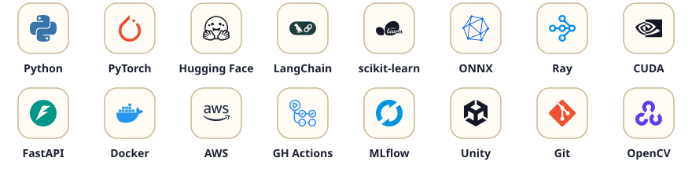</picture>

**GenAI & agents** · LangGraph · LangChain · RAG · QLoRA / LoRA · Pinecone · FAISS · Guardrails 
**ML & RL** · PyTorch · XGBoost · Ray RLlib · Unity ML-Agents · Hugging Face Transformers 
**MLOps** · MLflow · ONNX · Docker · GitHub Actions · AWS (EC2, S3) · Azure

 

<picture><source media="(prefers-color-scheme: dark)" srcset="assets/title-journal-dark.svg"></picture>

- **[Rebuilding Irminsul: From Demo to Something You Can Trust](https://mukulray1603.github.io/journal.html)** · Nov 2026
- **[Human vs AI Playtesters: 22 Issues, Only 2 in Common](https://mukulray1603.github.io/journal.html)** · Oct 2026
- **[I Built a Two-Player Mystery Game in 3.5 Weeks](https://mukulray1603.github.io/journal.html)** · Oct 2026
- **[6 Vikings, 2 Continents, 1 Server](https://mukulray1603.github.io/journal.html)** · Sep 2026

 

**M.S. Applied Machine Learning, University of Maryland** · Open to AI/ML Engineer roles in GenAI, agentic AI, LLMOps and game AI

<picture><source media="(prefers-color-scheme: dark)" srcset="assets/footer-dark.svg">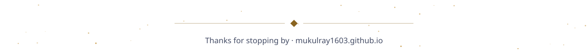</picture>

